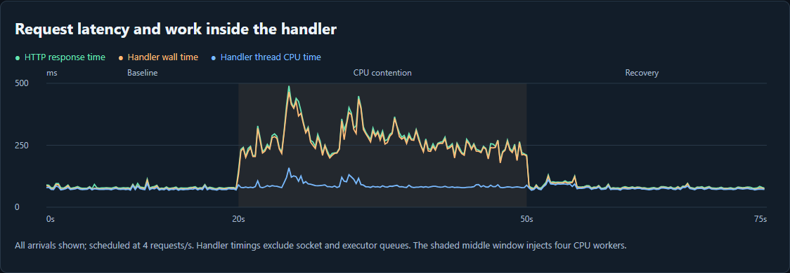

# Linux Performance Field Lab

**High load does not identify the bottleneck. Follow the work that is waiting.**

A technical portfolio project combining a read-only Linux collector, offline interactive evidence reports, and diagnostic case studies.

## Review the reports

**[Open the interactive reports on GitHub Pages](https://rahul-luthra.github.io/linux-performance-field-lab/)** — switch between Java experiments, Linux scenarios and individual host captures directly in your browser. No download or connection to the VM is needed.

For offline use, [download the review bundle](https://github.com/rahul-luthra/linux-performance-field-lab/releases/tag/review-v2), extract it, and open `app-report.html` with Edge, Chrome or Firefox. The tagged release is a fixed review snapshot; the live site follows the main branch.

For a quick preview directly on GitHub, this is the first measured run:



Read [how to view every report](VIEWING_REPORTS.md), [the application case study](APP_CASE_STUDY.md), [installation/reproduction](app/README.md), and [publishing guidance](PUBLISHING.md). GitHub's repository viewer still displays [HTML source](app-report.html); use the Pages link above for the rendered report. The site is published from `main` → `/docs`.

Across the three application experiments, all 900 measured requests succeeded at an offered rate of four per second. First-run p95 latency rose from 92 ms baseline to 411 ms under CPU contention. The repeat measured 113 → 306 ms. A single run with the background workload limited to one CPU measured 91 → 177 ms: a partial mitigation with a cost to background CPU availability. See the case study for sample sizes, timing definitions, recovery and limitations.

## What this demonstrates

- Linux counter interpretation: CPU states, memory availability, pressure stall information, device latency and queues, interface errors and drops.
- Engineering judgment: competing hypotheses, missing evidence, bounded experiments, and verification after a change.
- Implementation quality: actual elapsed-time rates, reset handling, missing-data semantics, an unprivileged host collector, and no third-party Python dependencies.
- Privilege boundaries: the collector and Java application process run without root. The full application experiment uses sudo for package/service management, perf profiling of the application's separate service user, and creation of the transient CPU-quota service.
- Communication: a reviewer can explore the evidence first, then inspect the code and reasoning.

This is a focused diagnostic prototype. It does not replace fleet monitoring, historical storage, application instrumentation, or production alerting. The current collector uses host scope; run it directly on a Linux VM/host. Container procfs visibility may not match the workload's cgroup entitlement.

## Start here

1. [Open the Java application investigation](https://rahul-luthra.github.io/linux-performance-field-lab/) or [the Linux host scenarios](https://rahul-luthra.github.io/linux-performance-field-lab/showcase.html). See [viewing instructions](VIEWING_REPORTS.md) for individual captures and offline use.
2. Read [the measured CPU investigation](LIVE_RESULTS.md), [the illustrative I/O case study](CASE_STUDY.md), and [the investigation runbook](RUNBOOK.md).
3. On Linux, capture your own measurements and generate the same report.

Python 3.9+ is required. Report generation and tests also work on Windows/macOS.

```sh
python3 monitor.py capture --samples 90 --interval 1 --out capture.json
python3 monitor.py report capture.json --out my-linux-report.html
python3 -m unittest -v
```

The capture lasts approximately samples × interval seconds, plus collection overhead. Each rate uses the measured monotonic elapsed time. Ctrl+C saves completed intervals. Optional unreadable sources become unavailable, with warnings; missing required CPU/memory/load sources stop capture. Output paths must have existing parent directories. Reports embed their data and need no server, internet, or external chart library.

## Reproduce a real CPU investigation

Use an isolated **2-vCPU Linux VM** with Python and no other important workload. PSI is optional; when absent, use the independent runnable-queue and per-core evidence. This workload is opt-in and ends after 30 seconds. It is intended to create contention; do not run it on a shared or production server.

To use the same automated protocol as the measured showcase:

```sh
python3 run_live_lab.py --isolated-lab
python3 analyze_results.py
```

This records 15 baseline intervals, launches four workers for 30 seconds, and records recovery through interval 75. It saves workload launch/exit observations, environment metadata, and bounded `vmstat`, `mpstat` and `pidstat` logs where installed. The first recorded run predates the addition of pidstat; process logs are present for its repeat. Each observer is sampled independently. Inspect phases and raw timestamps; boundary intervals include process startup/shutdown. All observer processes are stopped when recording finishes.

Alternatively, run the capture and workload manually:

Terminal A:

```sh
python3 monitor.py capture --samples 90 --interval 1 --out cpu-lab.json
```

After approximately 20 seconds, in terminal B:

```sh
python3 lab_cpu.py --isolated-lab --workers 4 --seconds 30
```

Then:

```sh
python3 monitor.py report cpu-lab.json --out cpu-lab.html
```

Record VM CPU/memory, distribution/kernel, Python version, background activity, start/end times, and the exact workload command. Compare the baseline, workload, and recovery windows. Look for CPU execution and CPU PSI increasing together, then falling after the workload ends. Load average smooths over time and may remain elevated into recovery. The example traces intentionally simplify this behavior and do not predict your measurements.

If PSI is unavailable, the report must say unavailable; inspect `vmstat` and per-core `mpstat` separately. A four-worker workload may behave differently under CPU quotas or a contended hypervisor. Explain deviations rather than editing data to match expectations.

## How to present it

Lead with this question: **“The load average is high, but CPU use is modest. What evidence would you collect before adding CPUs?”** Open the I/O scenario, show pressure and per-device latency together, explain why the storage hypothesis is stronger, and identify the missing process/application evidence. Then show your real CPU lab capture and describe how you reproduced and verified it.

For a résumé, link to the project with a precise description: “Linux Performance Field Lab — a read-only /proc collector, interactive diagnostic reports, and tested CPU/PSI/I/O calculations.” Only add claims about measured improvements once you have measurements.

For a two-minute walkthrough: 20 seconds on the problem, 45 seconds examining evidence, 30 seconds on competing explanations, and 25 seconds on the real lab and limitations. Share the case study as a short post that links back to the report and source.

## Metric definitions

| Metric | Calculation / meaning |
|---|---|
| CPU executing % | Delta(user + nice + system + irq + softirq) / delta(first eight CPU counters). Guest counters are already included in user/nice and are not added again. |
| Iowait / steal % | Separate deltas over the same CPU denominator. Decreasing counters invalidate the interval. Iowait alone is not a storage diagnosis. |
| PSI some/full % | Delta(total microseconds) / actual elapsed microseconds × 100. Some: at least one task stalled. Full: all non-idle tasks stalled. System CPU full is excluded. |
| Available memory % | MemAvailable / MemTotal × 100. Missing MemAvailable remains unknown. |
| Read/write await | Delta(read milliseconds + write milliseconds) / delta(read + write completions). Null if no completions; no discard/flush contribution. |
| Device average queue | Delta(weighted I/O milliseconds) / elapsed milliseconds. |
| Device busy % | Delta(I/O busy milliseconds) / elapsed milliseconds × 100, capped at 100 for sampling artifacts. Not a universal saturation measure. |
| Disk throughput | Sector deltas × 512 / elapsed seconds, converted to MiB/s. Keep devices separate to avoid counting stacked I/O twice. |
| Interface throughput/errors/drops | Per-interface counter deltas / actual seconds. Interfaces are not summed; link capacity and TCP retransmits are not collected. |

Reads are sequential snapshots rather than atomic system-wide measurements; timing skew can matter at short intervals. PSI values are bounded at 100%. A counter reset omits the affected device/interface interval or marks CPU/PSI unknown. Devices/interfaces first seen during an interval are omitted until a comparison exists. A reset followed by enough increments to exceed the old value cannot be detected from two snapshots.

## Validation and provenance

The supplied four scenarios are deterministic, hand-designed synthetic signals, dated to an illustrative timeline. They are not captured incidents, benchmarks, or evidence of a fix. Rebuild with `python3 make_demo.py`.

The unit tests exercise fixture-based procfs parsing, counter arithmetic, resets, topology changes, unavailable PSI/memory, zero completions, network errors/drops, and safe JSON embedding. All 14 tests passed on both Windows and Oracle Linux 9.7 / Python 3.9.25. Live capture, report generation and the CPU workload were exercised on the Linux VM. See [measured results](LIVE_RESULTS.md) and [validation](VALIDATION.md) for the scope and evidence. No performance-overhead benchmark or application improvement is claimed.

Before sharing a real capture, review timestamps, device/interface names, and infrastructure characteristics. The collector omits hostnames, process command lines, and environment variables. Independent sysstat logs contain process names and PIDs; their header hostname has been replaced with `lab-vm` in the distributed copies. Original logs remain on the VM.

## Sources

- [Linux /proc documentation](https://www.kernel.org/doc/html/latest/filesystems/proc.html)
- [Linux pressure stall information](https://www.kernel.org/doc/html/latest/accounting/psi.html)
- [Linux I/O statistics](https://www.kernel.org/doc/html/latest/admin-guide/iostats.html)
- [Brendan Gregg: USE method](https://www.brendangregg.com/usemethod.html)
- [Linux cgroup v2](https://docs.kernel.org/admin-guide/cgroup-v2.html), for follow-up workload-scope investigations.
