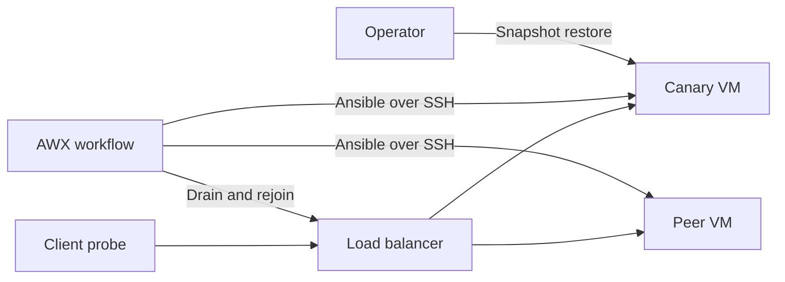

# The Canary Failed

[Interactive comparison](https://rahul-luthra.github.io/linux-performance-field-lab/patching.html) · [Normal capture](../results/patching/normal.json) · [Failure capture](../results/patching/failed.json) · [Derived summary](../results/patching/summary.json) · [Normal AWX screenshot](../docs/patching-normal-awx.png) · [Failure AWX screenshot](../docs/patching-failed-awx.png)

I tested rolling Linux maintenance with two disposable Ubuntu 24.04.5 LTS VMs. A small quote application returned a known response, and a load balancer sent requests to the eligible targets. The client scheduled four requests per second across each trial and recorded response correctness, latency, and the serving VM.



Both hosts started with Ubuntu's `tzdata` version `2024a-2ubuntu1` installed from the signed Noble release archive. The approved update was `2026e-0ubuntu0.24.04.1`. I scheduled a reboot on each patched target to exercise the maintenance path.

AWX first verified both hosts and paused for approval. For each target, it drained the VM, waited for requests already in flight, installed the approved version, and rebooted. It checked the installed version, verified that the boot ID changed, and requested an actual quote before returning the node to rotation. The load balancer made its own quote check before rejoining a host.

In the failure run, a controlled fault changed the canary's quote from 42 to 0 after the reboot. HTTP status remained 200. AWX failed the semantic check, ran its containment branch, and left the peer untouched. I restored the canary's powered-off VirtualBox snapshot and verified the old package version, a new boot identity, and the correct quote before rejoining it.

## Measured results

| Trial | Sent | Valid | Client errors | Skipped offers | Client p95 |
|---|---:|---:|---:|---:|---:|
| Normal rollout | 946 | 946 | 0 | 214 | 30.72 ms |
| Failed canary | 784 | 784 | 0 | 357 | 33.97 ms |

AWX workflow 21 patched and rebooted both VMs one at a time. During the stable drain windows, the peer served 227 valid quotes while the canary was out, and the canary served 250 while the peer was out.

In workflow 32, the peer served 484 valid quotes during the stable canary drain window. The canary returned to rotation 106.2 seconds after the failed application check. From the operator's shutdown request to a verified response from the restored guest took 53.0 seconds. The peer was still on the original package version.

## Reproduce the trials

1. Create two independent VMs from a verified Ubuntu cloud VMDK. Generate separate Ed25519 keys for the controller and AWX. Use [make_seed.py](make_seed.py) with `pycdlib` to build `patch-canary.iso` and `patch-peer.iso` from the public keys. Put the two ISOs and [create_vms.ps1](create_vms.ps1) in one Windows staging folder. The script checks the source SHA-256 and scopes the four forwarded ports to the controller and VirtualBox host. [Canonical release images](https://cloud-images.ubuntu.com/releases/noble/release/)
2. Record each target's Ed25519 host key from its serial log before authenticating. Install [backend.py](backend.py) at `/opt/patch-demo/backend.py` and [patch-demo.service](patch-demo.service) at `/etc/systemd/system/patch-demo.service`. Create `/etc/patch-demo` and enable the service. Verify `/quote` returns the expected hostname and quote.
3. Refresh the signed apt indexes. Set the same pre-change package version on both targets, verify that the later version is available, and keep any automatic package-update timers disabled during the experiment. On each target, use `apt-cache policy tzdata` and `dpkg-query -W tzdata` to verify the baseline.
4. Put [snapshot.ps1](snapshot.ps1) in the Windows user's `patch-rollout-lab` folder. Use [control.py](control.py) from the controller with its pinned SSH configuration. Its `take` action gracefully shuts down the two VMs, creates each `pre-patch-baseline` snapshot, starts the VM, and verifies the original package and healthy quote.
5. On the AWX VM, stage the `patching` sources and [incident/awx_lab.py](../incident/awx_lab.py). Create a private lab directory with the AWX private key as `awx`, the pinned keys as `known_hosts`, and a mode-0600 `config.json`. The pool needs the backend URLs and a private bind address reachable from the AWX execution pods. The AWX configuration uses the same private pool URL.

   ```json
   {
     "host": "<VirtualBox host address>",
     "bind": "<private address reachable from AWX pods>",
     "port": 8750,
     "pool_url": "http://<private address>:8750",
     "token": "<unique random token>",
     "ssh_ports": {"patch-canary": 2321, "patch-peer": 2322},
     "backends": {
       "patch-canary": "http://<VirtualBox host address>:8321",
       "patch-peer": "http://<VirtualBox host address>:8322"
     },
     "package": {"patch_package": "tzdata", "patch_from": "2024a-2ubuntu1", "patch_to": "2026e-0ubuntu0.24.04.1"}
   }
   ```

6. Start `python3 patching/pool.py config.json` on the AWX VM. From the staged source root run `sudo python3 -m patching.awx_rollout "$PWD"` to configure the dedicated AWX inventory, temporary credential, templates, and workflow. The script uses the cluster-only AWX service and an installed AWX execution image. [AWX workflow job templates](https://docs.ansible.com/projects/awx/en/24.6.1/userguide/workflow_templates.html)
7. Run `sudo python3 -m patching.run "$PWD" normal`. The operator script approves the scoped lab change only after receiving preflight evidence for both hosts. Use `control.py reset` to restore both snapshots between trials.
8. Run `sudo python3 -m patching.run "$PWD" failed`. When the runner reports `awaiting_snapshot_restore`, run `control.py --out restore.json recover` from the controller. Copy that JSON into the private AWX directory using an atomic rename to `restore.json`. The runner verifies the evidence, requires the pool to contain only the peer, and makes an independent successful quote check before rejoining the canary.
9. Copy the two captures to `results/patching`, run `python patching/build_report.py`, and then run `python build_pages.py`. Stop the lab services and targets after testing, and remove the temporary AWX credential and the scoped firewall rule when the VMs are no longer in use.

## Measurement scope

The client p95 uses successful observations and nearest-rank percentiles. The probe shared the AWX guest and missed some of its scheduled dispatches. The captures retain those offers, and the replay shows the longest gap between sent requests. Availability results apply to requests that were dispatched. The drain-window counts exclude one second after the drain marker and two seconds before the rejoin marker to account for workflow logging delays. The load balancer also waits for requests already in flight before the target can be patched.

The snapshot result applies to a stateless lab service with a powered-off checkpoint. A stateful production service would need its own plan for data consistency, replication and restoration. The fixed-rate results describe the recorded traffic and lab conditions.

## Preflight findings

The first capture stopped when the AWX approval API timed out after accepting the approval. I canceled the remaining workflow, restored both baseline snapshots, and changed the runner to reconcile delayed responses against the existing approval job. The published capture comes from the complete rerun.

The first failure trial isolated the canary, then the containment audit found no host matching its AWX limit. I added an explicit localhost entry with a local connection and verified the audit independently before repeating the failure trial.

The completed failure workflow shows a successful containment branch, a failed canary node, and no peer job. AWX displays the overall workflow as successful because the failure was handled.
